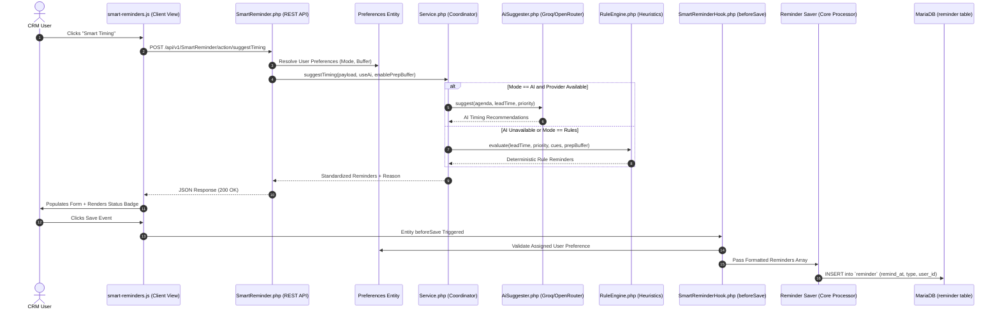
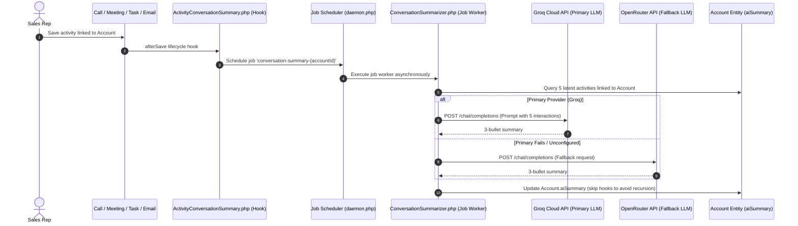
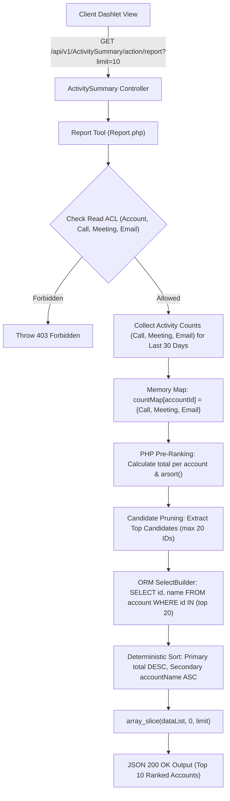

# System Architecture Specification

## 1. Architectural Overview

EspoCRM utilizes a **Single-Page Application (SPA)** frontend coupled with a **RESTful PHP backend** built on a metadata-driven, modular architecture. All custom features developed in this project adhere strictly to the extension paradigm (`custom/` directory and client custom namespaces), ensuring zero core file modifications and seamless upstream upgrade compatibility.

---

## 2. System Data Flow Diagrams

### Diagram A: Smart Reminders & AI-Suggested Timing Flow



---

### Diagram B: AI Conversation Summarizer Flow



---

### Diagram C: Activities per Account Dashboard Query Optimization



---

## 3. API Endpoints Specification

### 1. `POST /api/v1/SmartReminder/action/suggestTiming`
Suggests optimal reminders and timing lead times based on meeting metadata and user preferences.
- **Request Headers**:
  - `Content-Type: application/json`
  - `Espo-Authorization: <Token>` or CRM session cookie
- **Request Body**:
  ```json
  {
    "entityType": "Meeting",
    "name": "Architecture Review and Slide Deck",
    "description": "Prepare demo and review contract clauses.",
    "dateStart": "2026-10-30 14:00:00",
    "priority": "High",
    "useAi": true,
    "enablePrepBuffer": true
  }
  ```
- **Response (200 OK)**:
  ```json
  {
    "reminders": [
      { "type": "Email", "seconds": 172800 },
      { "type": "Email", "seconds": 86400 },
      { "type": "Popup", "seconds": 7200 }
    ],
    "source": "ai",
    "reason": "High-priority meeting requiring multi-day advance warning and 2h preparation buffer.",
    "leadTimeSeconds": 313200
  }
  ```
- **Error Responses**:
  - `400 Bad Request`: When `entityType` is unsupported or `dateStart` is missing.
  - `403 Forbidden`: When read permission is denied on the entity scope.

### 2. `GET /api/v1/ActivitySummary/action/report`
Retrieves the top-ranked accounts by total activity volume over the last 30 days.
- **Query Parameters**:
  - `limit` (int, optional, default: 10, max: 100): Number of top accounts to return.
- **Response (200 OK)**:
  ```json
  {
    "from": "2026-09-26 14:00:00",
    "dataList": [
      {
        "Call": 15,
        "Meeting": 8,
        "Email": 24,
        "accountId": "653a1f9e",
        "accountName": "Acme Technologies",
        "total": 47
      }
    ]
  }
  ```

---

## 4. Database Schema & Metadata Extensions

All schema changes are declared via JSON metadata files in `custom/Espo/Custom/Resources/`:

### 1. Entity Definition Extensions (`metadata/entityDefs/`)
* **`Preferences.json`**:
  - `smartReminderEnabled` (type: `bool`, default: `true`): Master toggle for smart reminder automation.
  - `smartReminderMode` (type: `enum`, options: `["ai", "rules", "disabled"]`, default: `"ai"`): Controls timing calculation engine.
  - `smartReminderPreparationBuffer` (type: `bool`, default: `true`): Toggles 2-hour preparation buffers for agenda-heavy meetings.
* **`Account.json`**:
  - `aiSummary` (type: `text`): Stores the generated 3-bullet conversation summary.
* **`Meeting.json`, `Call.json`, `Task.json`**:
  - `fields.reminders.view`: Overridden to `"custom:views/meeting/fields/smart-reminders"` to mount the interactive frontend timing component.

### 2. Layout Extensions (`layouts/`)
* **`Preferences/detail.json`**: Appends the "Smart Reminders" settings panel to the user preferences interface.
* **`Account/detail.json`**: Appends the "AI Conversation Summary" side panel to the Account detail view.

### 3. Dashlet Extensions (`metadata/dashlets/`)
* **`ActivitySummary.json`**: Registers the "Activities per Account (Last 30 Days)" dashlet with title configuration and role-based ACL filtering.

---

## 5. Security & Access Control Architecture

1. **Query-Level Strict ACL**:
   All custom reporting tools utilize `SelectBuilderFactory::create()->withStrictAccessControl()`. This ensures that data access policies (ownership, team boundaries, tenant restrictions) are enforced directly within SQL queries rather than in application loops.
2. **Zero-Secret Storage Policy**:
   No API keys, database credentials, or tokens are persisted in source files. Credentials are read exclusively from environment variables (`GROQ_API_KEY`, `ESPOCRM_DATABASE_PASSWORD`).
3. **Data Sanitization & Privacy**:
   - The AI timing engine and conversation summarizer send only relevant activity snippets to external LLM providers.
   - If AI providers are unavailable, the system fails closed (preserves existing summaries or defaults to local deterministic rules), ensuring zero operational downtime.
