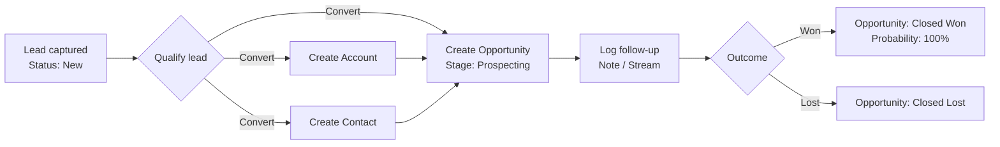

# Week 3 Day 2 — Lead-to-Closure Process Map

## Scope and test record

This is a local EspoCRM 10.0.10 walkthrough using a clearly labeled training record. No real customer data was used.

| Stage | EspoCRM entity | Observed fields and transition | API call checked |
| --- | --- | --- | --- |
| Capture lead | Lead | Name `Training Lead`, email `w3d2.lead@example.invalid`, Account Name `W3D2 Training Account`, Status `New` | `GET /api/v1/Lead` |
| Qualify and convert | Lead → Account, Contact, Opportunity | Lead conversion created all three linked records; Lead Status changed to `Converted` | Lead response includes `createdAccountId`, `createdContactId`, and `createdOpportunityId` |
| Create customer | Account | Account Name `W3D2 Training Account` | Account link visible on converted Lead and Opportunity |
| Add customer contact | Contact | Contact `Training Lead`, linked to `W3D2 Training Account` | `GET /api/v1/Contact` |
| Track deal | Opportunity | Name `W3D2 Training Opportunity`; Amount USD 1,111.00; Stage changed from `Prospecting` to `Closed Won`; Probability set to 100%; Close Date today | Opportunity was visible in the Lead conversion result |
| Record follow-up | Note (Stream post) | Posted a follow-up note on the Opportunity documenting review and closure | `GET /api/v1/Note` |

The three API calls were read-only GET requests made in the authenticated local browser. The returned records confirmed the Lead, Contact, and Note/Stream data. The Notes endpoint is used for the activity feed; EspoCRM's scheduled Activities entities are Meetings, Calls, and Tasks.

## Flowchart



## API endpoint notes

- `GET /api/v1/Lead` — returns a paginated `list` and `total`; the converted Lead includes its created Account, Contact, and Opportunity IDs/names.
- `GET /api/v1/Contact` — returns Contact records with account relationship fields such as `accountId` and `accountName`.
- `GET /api/v1/Note` — returns Stream note records. The follow-up post is a `Post` whose `parentType` is `Opportunity` and whose `parentId` identifies the deal.

Example calls from the authenticated local browser:

```text
http://localhost:8080/api/v1/Lead
http://localhost:8080/api/v1/Contact
http://localhost:8080/api/v1/Note
```

## Workflow, BPM, and report availability

The local instance's Administration page links to the Official Extensions catalog, which identifies Reports, Workflows, and Business Process Management as features of the Advanced Pack. The Advanced Pack is not installed in this local instance. Therefore, this walkthrough could not inspect three existing Workflow rules, two existing BPM flows, or two existing Reports; no rules or reports are fabricated here. The hands-on flow above documents the core Lead conversion and Opportunity process available in the installed CRM.

## Evidence captured

- EspoCRM dashboard loaded at `http://localhost:8080/`.
- Lead detail showed Status `Converted` and links to the created Account, Contact, and Opportunity.
- Opportunity detail showed Stage `Closed Won`, Amount `$1,111.00`, Probability `100`, and the follow-up Stream note.
- The three GET endpoints above returned JSON records successfully.
