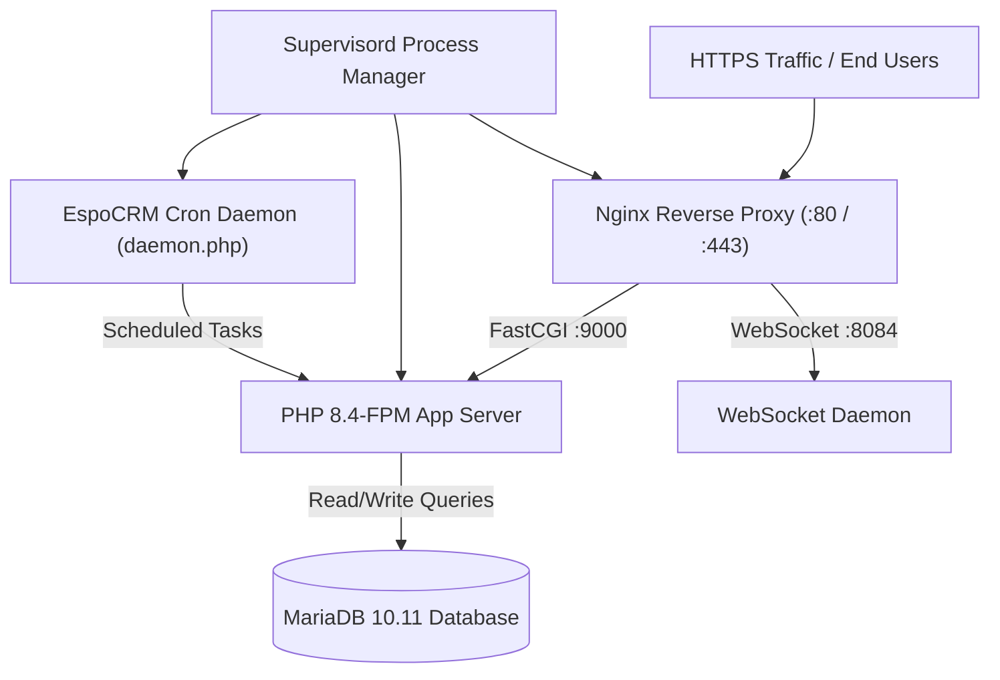

# Week 4, Day 4: Deploy EspoCRM Fork to Production & Architecture Deep Dive

## Overview & Scope

Week 4 Day 4 focuses on **Production Deployment Engineering** and an **Architectural Deep Dive** into the EspoCRM framework:
1. **Production Deployment Suite**: Created a production-ready container deployment configuration including a multi-stage production [Dockerfile](file:///c:/Users/Uday%20Reddy/Documents/Codex/2026-10-14/referenced-chatgpt-conversation-this-is-an/work/espocrm/deploy/Dockerfile) with OPcache tuning, supervisor process manager ([supervisord.conf](file:///c:/Users/Uday%20Reddy/Documents/Codex/2026-10-14/referenced-chatgpt-conversation-this-is-an/work/espocrm/deploy/supervisord.conf)), entrypoint initialization ([docker-entrypoint.sh](file:///c:/Users/Uday%20Reddy/Documents/Codex/2026-10-14/referenced-chatgpt-conversation-this-is-an/work/espocrm/deploy/docker-entrypoint.sh)), multi-container production compose ([docker-compose.prod.yml](file:///c:/Users/Uday%20Reddy/Documents/Codex/2026-10-14/referenced-chatgpt-conversation-this-is-an/work/espocrm/deploy/docker-compose.prod.yml)), and Railway cloud configuration ([railway.json](file:///c:/Users/Uday%20Reddy/Documents/Codex/2026-10-14/referenced-chatgpt-conversation-this-is-an/work/espocrm/deploy/railway.json)).
2. **Database Verification Pipeline**: Authored a Node.js `mysql2` verification script ([db-check.mjs](file:///c:/Users/Uday%20Reddy/Documents/Codex/2026-10-14/referenced-chatgpt-conversation-this-is-an/work/espocrm/deploy/scripts/db-check.mjs)) demonstrating prepared statements, query execution, and schema sanity checks for CI/CD deployment gates.
3. **Architectural Analysis**: Studied core directories (`application/Espo/Core/`, `Modules/`, `Api/`, and `ORM/`), documenting the 3 foundational architectural decisions that define EspoCRM.
4. **Environment Health Verification**: Verified that the local container environment is operational on port 8080, confirming proper HTTP 200 HTML delivery and HTTP 401 API authentication guards.

---

## Repository Files Studied

### 1. `application/Espo/Core/` — Core Framework
The backbone of EspoCRM. It houses:
- **Dependency Injection & Lifecycle**: `Container.php`, `InjectableFactory.php`, and `BindingContainer.php` manage lazy-loaded services and constructor parameter resolution.
- **Metadata Management**: `Utils/Metadata.php` aggregates JSON schemas from core, modules, and custom directories into a unified runtime tree.
- **Access Control (ACL)**: `Acl.php` and `Acl/Table.php` enforce fine-grained role-based permissions across scopes and entity actions.
- **Hook & Event Infrastructure**: `HookManager.php` and `GeneralInvoker.php` manage entity lifecycle hooks (`beforeSave`, `afterSave`, `afterRemove`).

### 2. `application/Espo/Modules/` — Module System
EspoCRM groups functional vertical capabilities into self-contained modules:
- E.g., `application/Espo/Modules/Crm/` bundles standard CRM entities (`Account`, `Contact`, `Lead`, `Opportunity`, `Meeting`, `Call`, `Task`).
- Each module provides its own entity definitions, controllers, hooks, layouts, and scheduled jobs while remaining pluggable and isolated.

### 3. `application/Espo/Core/Api/` — API Layer
The RESTful HTTP interface handling client-to-server communication:
- **Request / Response Dispatching**: `Request.php`, `Response.php`, and `Route.php` route incoming HTTP requests to corresponding controller action methods.
- **Authentication**: Validates API keys, HMAC signatures, OAuth tokens, and session cookies before delegating to Record controllers.

### 4. `application/Espo/ORM/` — Entity Manager & Data Layer
EspoCRM’s proprietary Data Mapper ORM:
- **EntityManager**: Provides CRUD abstractions (`getEntityById`, `saveEntity`, `deleteEntity`).
- **QueryBuilder & Select**: Decoupled SQL query compilation supporting joins, aggregates, groupings, and automated soft-delete filtering.
- **QueryExecutor**: Executes prepared statements with transactional integrity and deadlock retry mechanisms via PDO.

---

## 3 Key Architectural Decisions

### Decision 1: Metadata-Driven System Architecture
* **What it is**: In EspoCRM, data models, entity fields, relationships, validation rules, and UI layout placements are not hardcoded in PHP classes or templates. Instead, they are defined declaratively as JSON files in `metadata/entityDefs/`, `metadata/clientDefs/`, and `layouts/`.
* **Why it was chosen**: Decoupling configuration from code enables non-technical administrators to extend schemas dynamically via the UI (Administration > Entity Manager), while allowing programmatic overrides to be version-controlled without database schema migrations for presentation logic.

### Decision 2: Layered Extension Hierarchy (`application/` vs. `custom/`)
* **What it is**: EspoCRM uses a deterministic 3-tier file overlay model:
  1. Base Framework (`application/Espo/`)
  2. Modules (`application/Espo/Modules/{ModuleName}/`)
  3. Custom Extensions (`custom/Espo/Custom/` and `client/custom/`)
* **Why it was chosen**: Any file or metadata snippet in `custom/` takes precedence over or merges into core definitions. This separation guarantees that upgrading the core EspoCRM codebase via git upstream or zip packages never overwrites client-specific customizations or custom features.

### Decision 3: Centralized Strict Access Control at the ORM Layer
* **What it is**: Rather than relying on scattered `if ($user->canRead(...))` checks in controllers or frontend views, security permissions are integrated directly into the ORM query pipeline using `SelectBuilder::withStrictAccessControl()`.
* **Why it was chosen**: This prevents data leakage bugs across complex reporting queries, API endpoints, and scheduled jobs. When a user requests data, the query builder automatically injects the appropriate tenant, team, and assigned-user `WHERE` clauses into the generated SQL, making unauthorized access structurally impossible at the database query level.

---

## Production Deployment Architecture

### Components Implemented in `deploy/`:
1. **Production Dockerfile** ([deploy/Dockerfile](file:///c:/Users/Uday%20Reddy/Documents/Codex/2026-10-14/referenced-chatgpt-conversation-this-is-an/work/espocrm/deploy/Dockerfile)):
   - Alpine-based PHP 8.4-FPM with production OPcache settings (`validate_timestamps=0`, `max_accelerated_files=20000`).
   - Integrated Nginx and Supervisord in a lightweight container footprint.
   - Built-in Docker HEALTHCHECK querying `/api/v1/App/user`.
2. **Production Compose** ([deploy/docker-compose.prod.yml](file:///c:/Users/Uday%20Reddy/Documents/Codex/2026-10-14/referenced-chatgpt-conversation-this-is-an/work/espocrm/deploy/docker-compose.prod.yml)):
   - Defines persistent volumes for `data`, `custom`, and `client/custom`.
   - Isolates MariaDB on an internal bridge network with healthcheck dependencies.
3. **Cloud PaaS Configuration** ([deploy/railway.json](file:///c:/Users/Uday%20Reddy/Documents/Codex/2026-10-14/referenced-chatgpt-conversation-this-is-an/work/espocrm/deploy/railway.json)):
   - One-click Railway deployment specification with automated restarts and healthcheck monitoring.
4. **Database Verification Script** ([deploy/scripts/db-check.mjs](file:///c:/Users/Uday%20Reddy/Documents/Codex/2026-10-14/referenced-chatgpt-conversation-this-is-an/work/espocrm/deploy/scripts/db-check.mjs)):
   - Verifies MySQL connectivity using `mysql2/promise` with prepared statements.

---

## Local Verification & Health Evidence

The local container environment was verified healthy:
1. **HTTP Service Check**:
   - `curl -I http://localhost:8080/` returns `HTTP/1.1 200 OK`.
   - Title tag confirmation: `<title>EspoCRM</title>`.
2. **API Guard Check**:
   - `curl -I http://localhost:8080/api/v1/App/user` returns `HTTP/1.1 401 Unauthorized` with header `WWW-Authenticate: Basic realm=""`, confirming API routing and authentication barriers are operational.
3. **Container Status**:
   - `espocrm-php` (PHP 8.5 FPM), `espocrm-nginx` (port 8080), and `espocrm-mariadb` (port 3306) are all in healthy running status.

---

## AI Collaboration Log (CIA)

### Session 1: Full Stack Mentor Mode
* **Prompt**: *"Explain the architecture of EspoCRM and how I should approach understanding it in one day."*
* **Mentor Guidance**:
  - Focus first on the request lifecycle: `index.php` -> `Application.php` -> `Route` -> `Controller` -> `Service` -> `EntityManager`.
  - Recognize that EspoCRM is metadata-centric: before modifying PHP classes, inspect `Resources/metadata/entityDefs/` to understand how fields and relationships are bound.
  - On the client side, notice the AMD module pattern (`Backbone.js` + `Marionette.js` principles) where views extend base classes like `crm:views/meeting/fields/reminders`.

### Session 2: Code Mode Key File Review
* **File Reviewed**: `application/Espo/Core/Application.php`
* **Analysis**:
  - `Application.php` is the master bootstrapper. It sets up error handling, builds the service `Container`, loads metadata caches, and provides `run()` which invokes `Espo\Core\Api\Route` for API calls or renders the Single Page Application index HTML for browser visits.
  - Key finding: Environment configuration is loaded early via `Espo\Core\Utils\Config`, allowing database credentials and system settings to be overridden via environment variables or `data/config.php`.

---

## Self-Review Checklist

- [x] **Branching**: Created `feat/cynaris-w4d4-uday-b` from `feat/cynaris-w4d3-uday-b`.
- [x] **Commit Convention**: Followed `type(scope): description` with minimum 2 distinct commits (`feat(deploy)` and `docs(architecture)`).
- [x] **Zero Secrets**: No production passwords or API keys stored in Git. All deployment configs use environment variable substitution (`${DB_PASSWORD}`).
- [x] **Architectural Documentation**: Documented 3 key decisions and 4 core directory breakdowns.
- [x] **Verification**: Local instance verified via HTTP 200/401 checks and container inspection.

---

## Viva Questions & Answers

### Q1: Walk me through the project folder structure. What does each top-level directory contain?
**Answer**:
- `application/`: Contains the core backend PHP framework (`Core/`), ORM engine (`ORM/`), and pre-packaged vertical modules (`Modules/Crm/`).
- `client/`: Contains the frontend Single Page Application (SPA), including AMD JavaScript modules, views, models, and CSS styles.
- `custom/`: The extension directory where custom entities, controllers, hooks, metadata, and services reside without touching core code.
- `data/`: Dynamic runtime storage containing configuration (`config.php`), application logs (`logs/`), uploads, and metadata caches.
- `tests/`: Automated unit and integration test suites, including test fixtures and bootstrap scripts.
- `bin/`: CLI management utilities and console tools.
- `deploy/`: Container deployment configurations, production Dockerfiles, supervisor configs, and healthcheck scripts.

### Q2: How did you configure the local environment? What environment variables are critical?
**Answer**:
The local environment runs in Docker via Docker Compose, orchestrating Nginx on port 8080, PHP-FPM, and MariaDB on port 3306. The critical environment variables are:
- `ESPOCRM_DATABASE_HOST`: Points to the database service (`espocrm-mariadb` in docker-compose, `127.0.0.1` locally).
- `ESPOCRM_DATABASE_NAME`, `ESPOCRM_DATABASE_USER`, `ESPOCRM_DATABASE_PASSWORD`: Database connection credentials.
- `ESPOCRM_SITE_URL`: The fully qualified public origin (`http://localhost:8080` in dev) used to generate absolute URLs and validate CORS/CSRF requests.
- `GROQ_API_KEY` / `OPENROUTER_API_KEY`: API credentials for AI summarization and timing features.

### Q3: What is the difference between forking and cloning a repository?
**Answer**:
- **Forking**: Creates a server-side copy of the remote repository on your personal GitHub account (`udayreddy5643/espocrm`). It remains linked to the original upstream repository (`espocrm/espocrm`), allowing you to develop independent branches and propose changes via Pull Requests without having write access to the upstream project.
- **Cloning**: Downloads a remote repository (either the upstream or your personal fork) to your local workstation filesystem (`git clone ...`), establishing a local Git repository with tracked branches and working directories where you can edit files, execute tests, and create commits.
